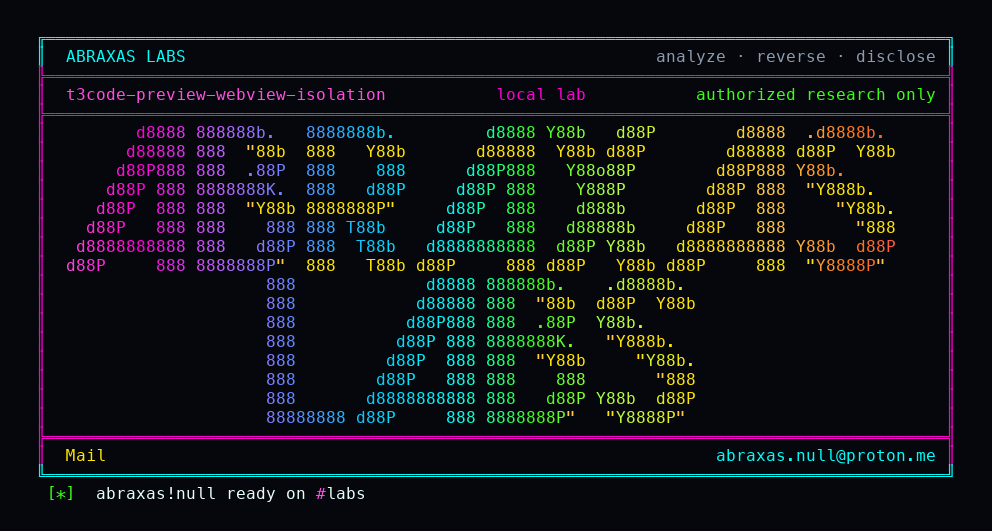

<p align="center">
  
</p>

# t3code-preview-webview-isolation

The preview pane turns off the wall between the page and the preload. `will-attach-webview` forces `contextIsolation = false` and leaves a page-supplied `preload` and `webpreferences` string in place. Invalid partitions are still blocked. Node integration stays off. Sandbox stays on. This is a second punch after a renderer is already compromised.

**Class:** Isolation leftover
**Reach:** Local (after renderer compromise)

**T3 Code** `61c3794c` - Ping

| | |
|---|---|
| ID | no CVE yet |
| Class | **Isolation leftover** |
| Reach | **Local** (compromised main renderer or compromised preview page) |
| CWE | [CWE-693](https://cwe.mitre.org/data/definitions/693.html) |
| CVSS | **Low: 3.6** `CVSS:3.1/AV:L/AC:H/PR:L/UI:N/S:C/C:L/I:L/A:N` |
| Product | [T3 Code](https://github.com/pingdotgg/t3code) |
| Affected | **61c3794c32b0eeebfac09add43e403618c65d2d7** |
| Auth | already inside the desktop renderer |
| License | [GNU Affero GPL v3.0](LICENSE) |
| Lab | Electron mock layer; preload path is a string oracle, never executed |

## What an attacker can do

Needs a compromised main renderer (or a preview page that can influence the `<webview>` tag). Does not get Node in the page from this handler alone.

| Privilege | Method / sink | Recon / integrity / availability | Lab-proven or inferred |
|---|---|---|---|
| Force `contextIsolation=false` on a preview webview | `DesktopWindow` `will-attach-webview` | Integrity (isolation off) | Lab-proven. handler-invoked=1, contextIsolation=False |
| Keep a planted `preload` path | same handler, incoming `webPreferences.preload` | Integrity | Lab-proven. preload-kept=1, witness `t3f03v2c8` in the path |
| Keep planted `webpreferences` | same handler | Integrity | Lab-proven. webpreferences-kept=1 (`nodeIntegration=yes` still present; `nodeIntegration` boolean still forced false) |
| Negative control: invalid partition | partition outside `persist:t3code-preview-` | n/a | Lab-proven. preventDefault |

**Stays closed on this leftover**

| Axis | Method / sink | Why it is closed |
|---|---|---|
| Integrity | `nodeIntegration` on this webview | handler sets false |
| Integrity | unsandboxed webview | handler sets `sandbox=true` |
| Integrity | attaching a non-preview partition | `event.preventDefault()` |
| Integrity | unauthenticated remote RCE | needs renderer compromise first |

`PREVIEW_WEBVIEW_PREFERENCES` is `contextIsolation=false,sandbox=true,nodeIntegration=false`. Electron's documented `will-attach-webview` requirement is to delete `preload` and `webpreferences` from page-supplied attributes.

## How I found it

The handler is inline on `window.webContents.on("will-attach-webview")`. I fired that listener on the existing DesktopWindow mock layer with a valid preview partition and a planted preload path.

Wrong turns: treating isolation-off as Node in the page today (sandbox and nodeIntegration still hold).

## Lab

```bash
python3 t3code-preview-webview-isolation-Abraxas-Labs.py
```

or:

```bash
cd lab
./run.sh
```

```text
IOC handler-invoked=1
IOC contextIsolation=False
IOC sandbox=True
IOC nodeIntegration=False
IOC preload-kept=1
IOC webpreferences-kept=1
IOC preventDefault-invalid-partition=1
SUCCESS T3-F03-WEBVIEW t3f03v2c8
```

## The fix

Set `contextIsolation = true` (or drop the line; true is the default). `delete webPreferences.preload; delete webPreferences.webpreferences;` before returning.

## References

- [github.com/pingdotgg/t3code](https://github.com/pingdotgg/t3code) `61c3794c32b0eeebfac09add43e403618c65d2d7`
- [`DesktopWindow.ts` will-attach-webview](https://github.com/pingdotgg/t3code/blob/61c3794c32b0eeebfac09add43e403618c65d2d7/apps/desktop/src/window/DesktopWindow.ts)
- [CWE-693](https://cwe.mitre.org/data/definitions/693.html)

## License

GNU Affero GPL v3.0. See [LICENSE](LICENSE). Loopback lab only. No warranty.

Abraxas Labs
abraxas.null@proton.me

Please credit CVE to Abraxas Labs.
